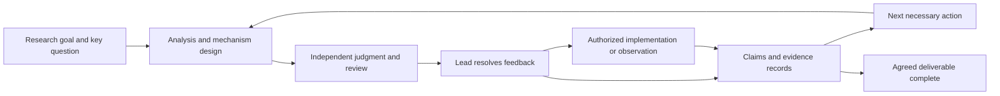

# Codex Research Orchestrator

**A multi-agent research framework built specifically for Codex. Keep autonomous research focused on the scientific question, meaningful innovation, and the user's goals.**

[MIT License](LICENSE) · [Skill entry point](skills/codex-research-orchestrator/SKILL.md) · [Design rationale](docs/design.md) · [Related work](docs/related-work.md)

## Why this project exists

This project grew out of the author's experience coordinating sustained research with multiple agents. The motivating problem is that agents can keep searching, discussing, running experiments, and writing while gradually losing the original scientific question. An easier substitute can become the target. A combination of familiar methods, presented fluently, can obscure a weak contribution. Without supervision, these deviations can accumulate across handoffs and produce a polished proposal with little research value.

The framework is designed around three goals:

1. **Identify the key scientific problem.** Each round states the current difficulty, the judgment that must change, and the evidence needed to change it. Analyze necessary conditions before choosing a method.
2. **Maintain continuity of research purpose.** Keep the original object, question, and confirmed constraints in an authoritative record. Allow methods and approaches to change when evidence rejects them.
3. **Stay aligned with the user.** Separate confirmed requirements, draft interpretations, execution permissions, and resource limits throughout research, review, implementation, and resumption.

These are the project's motivation and design goals. They do not establish that every existing framework produces weak work, or that this framework has already demonstrated superior research quality.

## The design contribution

The contribution is an inspectable **research collaboration protocol for Codex** that connects the mechanisms below. Multi-agent systems, reflection, review, and memory all have precedents; this project does not claim to have invented them.

| Design | What it changes in practice | Implementation |
|---|---|---|
| Progress through scientific questions and changed judgments | Each round explains which difficulty it resolves and which evidence changes the next step. More text or agent agreement is not enough. | [Research methods](skills/codex-research-orchestrator/references/method.md) |
| Separate constraints, decisions, and claims | Preserve the user's original requirements; revise method choices; make effectiveness and novelty claims open to refutation. | [Skill entry point](skills/codex-research-orchestrator/SKILL.md) |
| Independent judgment before collaboration | Isolate prior evaluations during key analysis and review, then compare derivations and counterexamples. | [Collaboration](skills/codex-research-orchestrator/references/collaboration.md) |
| Ground innovation in mechanisms | Compare substantive differences from the closest work, the properties those differences produce, and the contribution they support. Check conditions before transferring ideas across fields. | [Research methods](skills/codex-research-orchestrator/references/method.md) |
| Connect review, implementation, and evidence | Resolve findings individually, track review coverage by version and conditions, and preserve sources separately from current conclusions. | [Records](skills/codex-research-orchestrator/references/records.md) |
| Improve coordination without transferring control | An optional observer diagnoses repetition, stalled progress, and broken handoffs, then proposes evidence-based changes for the user to decide. | [Observation](skills/codex-research-orchestrator/references/observer.md) |

[Design rationale](docs/design.md) explains the expected effects and failure conditions. The contribution is in collaboration and workflow design. This release does not introduce a new foundation-model algorithm or claim field-wide priority or measured performance leadership.

## Built specifically for Codex

The framework enters through a Codex `SKILL.md` and loads references and project templates only when needed. The main chat leads the research. Subagents handle separable investigation, reasoning, and implementation. Project files preserve state across rounds. Available terminals, connectors, and chat tools carry out the work. [Codex integration](skills/codex-research-orchestrator/references/codex-runtime.md) maps these responsibilities to the host.

No separate Python multi-agent service or fixed model version is required. Available capabilities can differ across Codex CLI, IDE, and desktop clients; the skill follows the tools exposed in the current session. An external partner can be another researcher or model. ChatGPT Pro is one optional choice. Continuing in the current session and waking later are separate capabilities; the latter requires a user request and host scheduling.

The package follows the [official skill documentation](https://learn.chatgpt.com/docs/build-skills) and [subagent documentation](https://learn.chatgpt.com/docs/agent-configuration/subagents). This is an independent community project maintained by Aoudsung, with no OpenAI affiliation or endorsement.

## Relationship to existing projects

| Project | Focus described in its official materials | This project's focus |
|---|---|---|
| [AI Scientist-v2](https://github.com/SakanaAI/AI-Scientist-v2) | Topic-to-experiment-to-paper automation with experiment management, tree search, and feedback | Make research questions, constraints, independent judgment, and sustained handoffs explicit in a Codex workflow |
| [Agent Laboratory](https://github.com/SamuelSchmidgall/AgentLaboratory) | Multi-role research with human feedback, co-pilot mode, and state recovery | Maintain user requirements separately from scientific claims, with explicit review input isolation and feedback ownership |
| [AI-Researcher](https://github.com/HKUDS/AI-Researcher) | An end-to-end system for literature, ideas, implementation, validation, and papers | Connect research work to an existing Codex workspace and select evidence methods for the field |
| [karpathy/autoresearch](https://github.com/karpathy/autoresearch) | An agent edits a small training setup, runs it, compares a metric, and keeps improvements | Support open questions whose aims and evaluation still need research, including counterexamples, conditions, and claim revisions |
| [uditgoenka/autoresearch](https://github.com/uditgoenka/autoresearch) | Already supports Codex, bounded loops with success predicates, and single-pass exploration | Sustain open scientific inquiry through question alignment, revisable claims, independent assessment, and evidence records |

This comparison was checked on **2026-10-21**. It describes documented design emphasis, not limits on what other projects can be extended to do. Codex support, multiple agents, review, and resumption are not unique to this project. See [related work](docs/related-work.md) for direct sources and comparison limits.

## Install

To add the skill to a research project:

```sh
git clone https://github.com/Aoudsung/codex-research-orchestrator.git
mkdir -p /path/to/your-research-project/.agents/skills
cp -R codex-research-orchestrator/skills/codex-research-orchestrator \
  /path/to/your-research-project/.agents/skills/
```

Replace the example path with your project directory. If a skill with the same name already exists, compare versions before replacing local changes. You can also ask Codex's skill installer to install `skills/codex-research-orchestrator` from this repository.

The repository includes `plugin.json` for distribution as a skill-only plugin. It configures no external MCP service or background process and needs no API key in the repository. Research tools and execution environments come from the user's Codex session.

## Start research

In Codex, use:

```text
Use $codex-research-orchestrator to investigate this question: ...
Research object and constraints: ...
Available materials: ...
Deliverable for this task: ...
Allowed implementation, experiments, and external communication: ...
Available resources or budget: ...
```

You do not need to fill a long form first. Codex reads existing materials and asks only about gaps that materially affect the result or authorization. When persistent records are useful, it creates a research directory from the templates. Existing projects retain their own entry points.

To resume:

```text
Use $codex-research-orchestrator to continue research/my-topic.
Check the latest constraints, pause status, and running work before
starting the next necessary action.
```

A typical flow:



Choose steps according to the question; not every round needs every node. Theory can progress through proofs, and literature research through primary sources and counterevidence.

## Adapt to different fields

Change the research question, evidence standards, participants, and execution resources. Keep question alignment, independent judgment, feedback handling, and evidence-based continuation. The skill includes guidance for theory, computational systems, empirical observation, experiments, qualitative research, and reproduction.

- **Algorithms and systems:** preserve implementation and measurement semantics, and test mechanism claims against suitable comparisons.
- **Theory:** use definitions, derivations, proofs, and counterexamples without requiring training or benchmarks.
- **Empirical and qualitative research:** connect source selection and measurement or interpretation to claims; do not treat correlation or fluent narrative as causal evidence.

These are intended uses, not a claim of completed end-to-end validation in every field.

## Repository layout

```text
codex-research-orchestrator/
├── README.md
├── LICENSE
├── plugin.json
├── docs/                         # Design, comparisons, and validation
└── skills/codex-research-orchestrator/
    ├── SKILL.md                  # Codex skill entry point
    ├── agents/openai.yaml        # Display metadata
    ├── assets/project-template/  # Charter, settings, and current state
    └── references/               # Methods, collaboration, records, and integration
```

## Current scope

Version 0.1.0 is an instruction-and-template framework executed by an agent. It guides research decisions but does not provide program-enforced spending limits, an automated theorem prover, or an independent cluster scheduler. Research conclusions still need real evidence. Future evaluations can measure goal drift, support for key claims, the effect of independent review, and research output under matched budgets.

[Validation notes](docs/validation.md) state what was checked. Contributions should describe a concrete failure, its trigger, the current behavior, and the smallest useful correction. Avoid turning one project's special requirements into universal rules.

## Author and license

Created and maintained by [Aoudsung](https://github.com/Aoudsung), based on the author's sustained research collaboration practices. The collaboration instructions and templates were written for this project. Other open-source projects are cited for comparison and context; their established ideas are not claimed as original here.

Copyright © 2026 Aoudsung. Released under the [MIT License](LICENSE).
