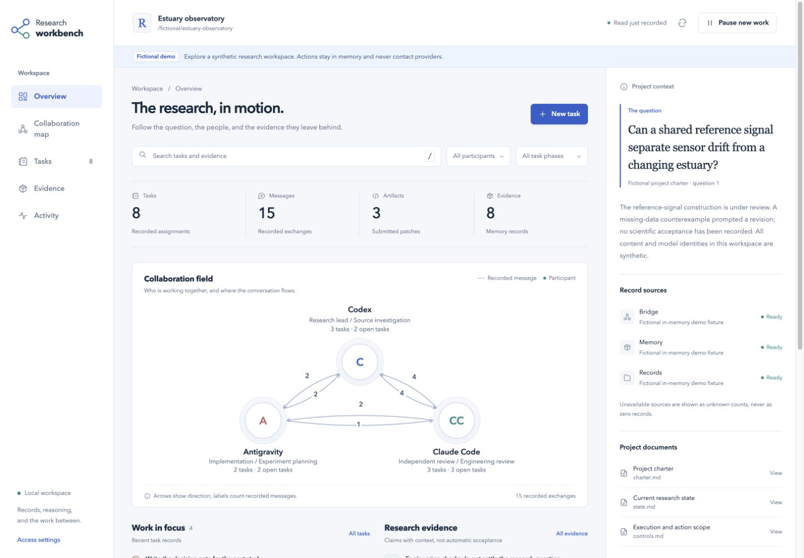

# Codex Research Orchestrator

**Start research with one goal. Keep the scientific question, evidence, and next action connected. Bring Claude Code and Antigravity into the work when you need them.**

[Get started](docs/getting-started.md) · [Workbench](docs/workbench.md) · [Changelog](CHANGELOG.md) · [Connect agents](docs/mcp-setup.md) · [Design](docs/design.md) · [Related work](docs/related-work.md) · [MIT License](LICENSE)

Boost, Swarm, and Teamwork are discoverable Codex skills. The Lead selects an authorized workflow, plans it from the real task, and coordinates bound collaborators. The [work-run protocol](skills/codex-research-orchestrator/references/work-modes.md) covers planning, dispatch and resumption. Projects choose eligible collaborators through the [model catalog](runtimes/agent-bridge/docs/model-catalog.md).

The bundled bridge also supports [workflow protocol 2](runtimes/agent-bridge/docs/workflow-v2.md): versioned task contracts, durable business receipts, precise decisions, ownership handoffs and event-driven continuation. Existing tasks retain their protocol and sessions. The runtime release manifest identifies the shared source used by installed and publication copies.

## Start in three steps

Requires **Python 3.11+** for setup. Node.js and external provider accounts are optional.

**1. Install the complete bundle into a research workspace.**

```sh
git clone https://github.com/Aoudsung/codex-research-orchestrator.git
cd codex-research-orchestrator
python3 setup.py install --project ../my-research
```

Use a workspace name of your choice. The installer copies the orchestrator, the three collaboration skills, and the bundled bridge files into the chosen workspace. It registers no accounts or global settings and starts no background services. You can move or remove this checkout after installation.

**2. Open `my-research` in Codex and give it your question.**

```text
Use $codex-research-orchestrator to start researching:
[Your question here.]
```

Codex creates the records it needs from your request. You do not need to complete a long template or choose an agent team first. It asks only about missing information that materially changes the research or its permissions.

**3. Continue in ordinary language.**

```text
Use $codex-research-orchestrator to continue this project.
```

Codex checks the current goal, evidence, pending work, and next action before proceeding.

If the skill is not listed, start a new turn in the target workspace; restart the client if necessary. See [the first-run guide](docs/getting-started.md) for manual setup and troubleshooting.

## Choose how the work runs

| Request | What happens |
|---|---|
| “Use `$boost` to find and verify the cause of this regression.” | An owner proposes a source-linked explanation or implementation. A fresh challenger tries to falsify or break it. The owner can repair it, and the Lead spot-checks the result. |
| “Use `$swarm` to investigate these independent symptoms.” | Named members cover distinct scopes, post evidence to the persistent board, and hand off to the next actor. Integration and fresh verification check consequential findings. |
| “Use `$teamwork` to finish this project through its dependent milestones.” | The Lead records approved scope and evidence requirements. Milestones track upstream versions. An independent final audit checks the delivered outcome. |

Ordinary language also works. If the client passes a slash command through as text, the Lead reads a prefix such as `/teamwork` or a chip such as `[/teamwork](slashCommand;teamwork)` as an explicit mode request. `$skill` is the Codex invocation mechanism. “Use Teamwork, with Boost for every substantive assignment” applies the challenge and revision cycle inside the project milestones. Routine bounded work stays with one owner. The plan, task bindings, and board stay with the project, so “continue this Swarm” resumes the existing run.

Mode execution uses the project-local Lead bridge with an actual host session and authorized worker routes. If the Lead tools are missing or the client is registered as another participant, use the installed helper's `doctor --client codex` to inspect the project configuration, repair the requested connection through `connect`, and reload the host. [Connection instructions](docs/mcp-setup.md)

From an active host session, the collaboration CLI also works when an old global MCP connection reports the wrong caller. Open a request by passing it verbatim or piping it into `open`. Keep the returned task ID for `resume`.

```sh
python3 .agents/skills/codex-research-orchestrator/scripts/research_setup.py collaborate --project . -- \
  open '/teamwork Plan a fair experiment comparison for 7B and 1.5B on TextCrafter, ALFWorld, and WebShop. Use /boost for every track.'
```

The same command works from a globally mounted skill's `scripts/research_setup.py` when the target project has the runtime. Lead and workers use its managed database or the project-local default. If using a custom project file, pass the same `--bridge-db` to each CLI invocation.
## Tutorial: onboard an existing active codebase

To attach `codex-research-orchestrator` to a repository that already has source code, active feature branches, `AGENTS.md`, or historical logs without touching tracked files or migrating legacy archives, follow these four steps.

**Step 1 — Isolate orchestrator files via `.git/info/exclude`** (leaves your working tree and `.gitignore` clean):

```sh
cat >> /path/to/existing-repo/.git/info/exclude <<'EOF'
# codex-research-orchestrator local collaboration state
.agents/skills/codex-research-orchestrator/
.agents/skills/boost/
.agents/skills/swarm/
.agents/skills/teamwork/
.agents/mcp_config.json
.research-orchestrator/
.research-memory/
.agent-bridge/
.codex/
controls.md
charter.md
project.md
state.md
EOF
```

**Step 2 — Probe, install, initialize, and connect with tiered MCP tool profiles.** `init` never overwrites existing `AGENTS.md`, `rules.md`, code, or legacy databases. Pass `--node /path/to/node24` explicitly if Node 24+ is not on your default `PATH`:

```sh
python3 setup.py probe --project /path/to/existing-repo --json
python3 setup.py install --project /path/to/existing-repo
python3 setup.py init --project /path/to/existing-repo \
  --title "Your Project Title" \
  --question "State your exact research question or failure-diagnosis target here."

# codex --peers antigravity (`claude-code` disabled unless declared in `controls.md`)
python3 setup.py connect --project /path/to/existing-repo --client codex --peers antigravity --node /path/to/node24 --tool-profile auto --apply
python3 setup.py connect --project /path/to/existing-repo --client antigravity --peers codex --node /path/to/node24 --tool-profile worker --apply
python3 setup.py lint --project /path/to/existing-repo --json
python3 setup.py doctor --project /path/to/existing-repo --client codex --peers antigravity
```

**Step 3 — Lock hard boundaries in `controls.md` and `charter.md`.** Every `research_context` call injects `controls.md` verbatim into the deterministic KV-cached prefix so rules do not decay mid-session. Keep `controls.md` concise (~20–30 lines):

```markdown
# Authoritative Controls

## Question (verbatim)
State your exact research question or bottleneck here.

## Collaboration & Model Routing Policy
- Participants: codex, antigravity
- forbid_claude_code: true
- strict_write_locks: true
- Lead Coordinator: `codex` (non-coding orchestrator; `BRIDGE_TOOL_PROFILE=lead`), dispatches **ChatGPT Web `Pro`** (`pro_macro`, standing repo/bundle auth, no SHA ceremony, checked every 15 min by `GPT-6 Luna`).
- Three Session Lanes: `GPT` (`Astra` formalization/efficiency/blind review, `6.2 Sol` coding, `default`/`explorer` + `gpt-6-luna` `low` for L0 monitoring) in Codex; `Gemini` (`Carbon` co-design, `Argon` coding) in pinned project PI sessions first with pinned/dedicated Antigravity fallback; `Kimi 3.1 Pro` / `DeepSeek V4.1 Flash` in project-rooted `.pi/sessions/` (`magpie` `auto/*`, `retries=0`). Keep `agent_type="Luna"` strictly for tool-free effort judging.

## Lint-First Discipline
- Run `python3 setup.py lint` to enforce doc budgets, git/secret isolation, write-root exclusivity, real-benchmark / endogenous-design guards, and claim binding instead of appending prose to `AGENTS.md`.
```

Record the observed baseline vs. candidate contrast and key file paths in `charter.md`.

**Step 4 — Seed compact SQLite pointer records and launch Round 1.** Rather than copying megabytes of historical logs into `.research-memory/memory.sqlite3`, insert 2–3 lightweight `source`, `evidence`, and `question` pointers via `.agents/skills/codex-research-orchestrator/scripts/research_memory.py --project /path/to/existing-repo api record`, export an initial `state.md` snapshot once, then open Codex in `/path/to/existing-repo` and send:

```text
Use $codex-research-orchestrator to resume from controls.md, charter.md, project.md and state.md.
```

Recommended Round 1 division of labor and model/effort routing:

| Role in Round 1 | Model / Tier | Session Lane & Effort | Responsibility |
|---|---|---|---|
| **Lead Coordinator** | `codex` (`lead`) | Codex CLI (`high`) | Orchestrates contracts, write-locks, `intake` guards, and acceptance; never edits business code directly. |
| **Chief Macro Architect** | **ChatGPT Web `Pro`** (`pro_max`) | Web Project (`15m` checked by `Luna` `low`) | Deepest first-principles framing over synced repo / bundle (`pack_pro_bundle.py`, no SHA ceremony); unrestricted reply depth. |
| **Mechanism & Blind Audit** | `Gemini Carbon` / `GPT Astra` | Pinned PI -> Antigravity (`Carbon`) / Codex (`Astra`) | `Carbon`: mechanism co-design & repo/log scan (no `blind_review`); `Astra`: mathematical formalization, efficiency audit & independent `blind_review`. |
| **Implementation & Server Runs** | `Gemini Argon` / `6.2 Sol` / `Kimi` / `DeepSeek` | Pinned PI/Agy / Codex / `.pi/sessions/` (`magpie` `auto/*`) | Builds core + baselines together before formal runs; runs real benchmarks on GPUs with `free VRAM >= peak + margin` (excluding faulty GPUs). |

## What to ask

| You want to… | Say this to Codex |
|---|---|
| Start | “Use $codex-research-orchestrator to investigate …” |
| Resume | “Continue this research from its current state.” |
| Understand progress | “What have we established, what remains uncertain, and what is next?” |
| Bring in a peer | “Connect this project to Claude Code for independent analysis.” |
| Check setup | “Check this project's research setup and show the next fix.” |
| Open the workbench | “Open this project's collaboration workbench.” |
| Pause | “Pause this research and leave a continuation note.” |

The skill handles ordinary setup details. You retain control of the research goal, material choices, external sharing, execution permissions, and budget.

## A visual workspace for collaboration

The optional local workbench brings the research question, collaboration map, task board, evidence, and activity into one interface. Inspect original sources, create and dispatch tasks, send replies, or pause new executions and automatic follow-up while already admitted calls finish. It distinguishes recorded task state, artifact delivery, validation claims, and host acceptance.



Try the fictional demo from the complete bundle, with Node.js 24+:

```sh
python3 setup.py workbench --demo --open
```

For a real project, use the installed helper's `workbench --project . --open` command. The demo contacts no providers. [Workbench guide](docs/workbench.md) explains source interpretation, task controls, and the exact pause behavior.

## Optional: connect Claude Code, Antigravity, or Codex

The shared MCP bridge enables reciprocal information exchange and task collaboration: participants can send requests, ask questions, return evidence and patches, and continue an authorized task with less manual relay.

For Codex to connect to Antigravity (or opt-in Claude Code), run this **from the installed research workspace**:

```sh
python3 .agents/skills/codex-research-orchestrator/scripts/research_setup.py connect \
  --project . --client codex --peers antigravity --tool-profile auto --apply
```

This requires **Node.js 24+**. The helper discovers real paths, generates a shared project database location, updates only project-local entries, preserves unrelated settings, and backs up changed configuration. Use `--tool-profile auto` on the Lead (`lead` for the primary peer and `exec_only` for extra peers) and `--tool-profile worker` on peer workers. Claude (`claude-code`) is disabled unless explicitly authorized in `controls.md`. Omit `--apply` to prepare the config without registering it.

Claude Code project configuration and Antigravity CLI/IDE workspace configuration are also supported. Antigravity uses `.agents/mcp_config.json`; its export remains available for other supported settings interfaces. Select only the peers you intend to use.

- **Reactive wakeup.** Workers exit after submitting a result or handing back ownership. Lead turns exit when a named successor owns the next action or an authorized external reply is pending. Session-bound wakeups resume the existing run with current steps and evidence.

Provider execution requires the selected CLI and its normal login. [Connection instructions](docs/mcp-setup.md) explain the final trust/reload step and a bounded first exchange.

## Check setup, lint, or upgrade

From the research workspace:

```sh
python3 .agents/skills/codex-research-orchestrator/scripts/research_setup.py lint --project .
python3 .agents/skills/codex-research-orchestrator/scripts/research_setup.py doctor --project .
```

The check is read-only and gives the next useful action. A missing optional bridge or Node installation does not prevent basic research in Codex.

To upgrade, obtain the new complete bundle and run its installer against the existing workspace:

```sh
python3 setup.py install --project ../my-research --upgrade
```

Managed replacements are backed up. Unmanaged skills with the same name and locally customized companion skills stay in place and are reported by name. Research records, memory, bridge data, and client configuration are retained. A normal repeat install is a no-op when unchanged.

The installed helper can restore a missing companion without the download. From the workspace, run `python3 .agents/skills/codex-research-orchestrator/scripts/research_setup.py install --project .`. To copy just the installed skill suite into another workspace, use the same helper with `install --project ../another-project --skill-only`. The helper copies the bundled mode files, including their own references, from the installed orchestrator.

## Choose an installation

| Package | Use it when |
|---|---|
| **Complete repository/bundle — recommended** | You want guided installation and the optional bridge ready to configure later |
| Standalone skill | You want Codex research and memory through the standalone skill installer. Use the complete bundle or an installed suite's helper to install all three mode skills. |
| Bridge runtime | You already manage skills and want the MCP component separately |

[Download releases](https://github.com/Aoudsung/codex-research-orchestrator/releases/latest). The full bundle includes `setup.py`; the standalone skill includes the same helper under `scripts/research_setup.py`. Native Codex research does not require all three providers.

## Why this framework exists

This project grew from the author's experience coordinating sustained research with multiple agents. Agents can keep searching, discussing, experimenting, and writing while gradually losing the original scientific question or overstating the value of a familiar combination of methods.

The framework is designed to:

- **Identify the key scientific problem:** connect each action to a difficulty, a judgment to change, and suitable evidence.
- **Maintain continuity of purpose:** preserve the original question and user constraints while allowing methods and hypotheses to be revised.
- **Stay aligned with the user:** keep confirmed requirements, draft interpretations, permissions, and resources distinct.

Its contribution is a practical collaboration protocol for Codex, source-backed research memory, and optional cross-agent coordination. The [design rationale](docs/design.md) explains the mechanisms; [related work](docs/related-work.md) gives direct comparisons with existing automation projects.

## How the parts fit

Version 1.2 introduces a 4-cut context and token-efficiency overhaul alongside L0–L4 dynamic effort routing: tiered and deduplicated MCP schemas (`BRIDGE_TOOL_PROFILE` `full | lead | worker | exec_only`), zero-copy deterministic `role`/`stance` headers plus tail-injected JIT recency checks anchored to a KV-cached `controls.md` prefix, automatic L0–L4 effort guidance with `>=2`-failure escalation (`jitGuidance`), and single-write SQLite research memory with on-demand `state.md` export.

Version 1.0 separates pure zero-I/O coordination rules from a durable SQLite effects queue, adds a deterministic Research Router (`off | observe | auto`) with thread subscriptions and out-of-scope `bridge_handback`, introduces a Dual-Layer Watchdog (`HealthBoard`, `+1` human-priority slot, two-phase `consumed_at` recovery, and `.optimizer/watchdog-events.jsonl` anti-spin probes), upgrades the workbench to an Attention-First overview, and protects customized project templates via `builtInBase` 3-way baselines.

Version 0.5 adds the local collaboration workbench and a shared execution pause. It makes the existing reciprocal collaboration between Codex, Claude Code, and Antigravity visible and actionable: trace messages, inspect their sources, give scoped assignments, and control when new work may begin.

Version 0.4 adds role-specific instructions for researchers, optional brainstormers, reviewers, implementers, collaboration optimizers, and fact observers. Only the assigned role is loaded. When direction is unclear, short independent constructions precede comparison; a main author then develops the supported direction while others supply complementary evidence.

Original research must combine rigorous support with a substantive contribution. A counterexample calls for a concrete reconstruction within the original object; a ruled-out route becomes evidence for a different approach. Reproduction, surveys, and bounded contributions retain their own completion criteria. Fact collection reports changes; process diagnosis remains with the optimizer.

| Part | Responsibility |
|---|---|
| Research skill | Question selection, independent reasoning, review, handoffs, and scientific alignment |
| Project records | Current goal, requirements, evidence, decisions, and continuation point |
| Memory helper | Typed source snapshots, lexical retrieval, dependency invalidation, and bounded context packets |
| Optional MCP bridge | Task/session bindings, messages, artifact revisions, validation feedback, and configured event delivery |
| Setup helper | Installation, minimal project initialization, selected connections, and read-only diagnostics |
| Collaboration workbench | Local visual exploration and explicit task, dispatch, messaging, and pause/resume controls |

The lead retains scientific decisions and final acceptance. External authors can perform analysis, implementation, self-checks, and repairs without the lead repeating their whole workflow. Independent reviewers receive curated materials, not an unrestricted shared inbox.

Memory and coordination state remain separate. Verify the host route before relying on idle-chat wakeup.

## Further reading

- [Getting started and everyday use](docs/getting-started.md)
- [MCP setup and first exchange](docs/mcp-setup.md)
- [Advanced memory commands](docs/memory-tool.md)
- [Research design and novelty](docs/design.md)
- [Memory design references](docs/memory-foundations.md)
- [v0.3 validation](docs/validation-v0.3.md)
- [Real-client communication and wakeup checks](docs/validation-v0.3.1.md)
- [v0.4 role and construction checks](docs/validation-v0.4.md)
- [v0.5 workbench validation](docs/validation-v0.5.md)

Public content is in English. The framework can support different research fields through project-specific questions, evidence standards, collaborators, and resources.

## Author and license

Created and maintained by [Aoudsung](https://github.com/Aoudsung).

Copyright © 2026 Aoudsung. Released under the [MIT License](LICENSE).
