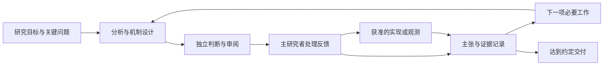

# Codex Research Orchestrator

**专为 Codex 打造的多智能体科研协作框架。让无人值守研究持续围绕关键科学问题、真实创新与用户需求推进。**

An open-source research collaboration skill built for Codex, with scientific problem selection, independent reasoning, and persistent alignment to the user's research goals.

[MIT License](LICENSE) · [技能入口](skills/codex-research-orchestrator/SKILL.md) · [设计依据](docs/design.md) · [相关工作对照](docs/related-work.md)

## 为什么做这个项目

本项目来自作者组织长期、多智能体科研协作的实践。促使我们设计这套方案的问题是：agent 可以持续搜索、讨论、运行实验和写稿，却仍可能逐步偏离原始科学问题，把容易完成的替代任务当作研究目标，或用已有方法的组合与流畅文字掩盖创新不足。无人值守会使这些偏差在多轮交接中累积，最终交出形式完整、研究价值却不足的方案。

我们因此围绕三个目标组织协作：

1. **把握关键科学问题。** 每轮明确当前困难、需要改变的判断和能支持判断的证据；分析必要条件，再选择研究方法。
2. **保持研究主线一致。** 原始对象、问题和用户确认的约束有权威来源；具体机制与路线可以推翻，避免为了局部成功偷换目标，也避免锁死错误方案。
3. **持续对齐用户需求。** 把已确认要求、草案解释、执行授权和资源边界分别记录，贯穿研究、审阅、实施与续接。

这是本项目的设计动机与目标。它不等于所有现有框架都产生低质量结果，也不等于本项目已经通过对照实验证明质量优势。

## 本项目的创新设计

本项目的贡献是把以下机制组织成一套可执行、可检查的 **Codex 科研协作协议**。多智能体、反思、审稿和记忆均已有相关工作；我们不将这些单独宣称为首创。

| 设计 | 在研究过程中实际改变什么 | 对应文件 |
|---|---|---|
| 以科学问题和判断变化推进 | 每轮说明解决什么困难、什么证据能改变下一步；文档增长和角色一致不计作充分进展 | [研究方法](skills/codex-research-orchestrator/references/method.md) |
| 约束、决策、主张分层 | 保留用户原始要求；方法选择可调整；有效性和创新主张必须能被反驳 | [技能入口](skills/codex-research-orchestrator/SKILL.md) |
| 独立判断后再合作 | 关键分析与审阅先隔离既有评价，再交换推导和反例，减少全体继承同一错误分解 | [协作规则](skills/codex-research-orchestrator/references/collaboration.md) |
| 将创新论证落实到机制 | 比较与最近工作的实质差异、差异带来的性质和贡献分量；跨领域借鉴必须给出结构对应与成立条件 | [研究方法](skills/codex-research-orchestrator/references/method.md) |
| 审阅、实施和证据续接 | 逐项处理反馈；审阅覆盖具体版本和条件；原文、当前判断与执行证据分别保存 | [记录规则](skills/codex-research-orchestrator/references/records.md) |
| 可观察但不越权的协作改进 | 观察者定位空转、重复劳动和交接断点，提交有证据的最小建议，由用户决定 | [观察规则](skills/codex-research-orchestrator/references/observer.md) |

预期作用及失效条件见 [设计依据](docs/design.md)。这里的创新属于协作机制与工作流设计；尚未提出新的基础模型算法，也没有宣称全领域首创或已验证的性能领先。

## 为什么专为 Codex

框架以 Codex 的 `SKILL.md` 为入口，按需加载参考规则与项目模板。主对话承担研究统筹；子代理承担可隔离的调查、推理和执行；项目文件承接跨轮状态；终端、连接器和可用的会话工具承接实际工作。具体映射写在 [Codex 接入](skills/codex-research-orchestrator/references/codex-runtime.md)。

不需要另起一个 Python 多代理服务，也不要求固定模型版本。Codex CLI、IDE 和桌面端的可用能力可能不同，技能以当前工具为准。外部研究合作方可以是另一位研究者或模型，ChatGPT Pro 只是可选绑定。当前轮内推进与跨时段唤醒分开：后者由用户要求并配置宿主调度。

技能结构与加载依据 [Codex 官方技能文档](https://learn.chatgpt.com/docs/build-skills)，子代理行为依据 [官方子代理文档](https://learn.chatgpt.com/docs/agent-configuration/subagents)。本项目由 Aoudsung 独立维护，与 OpenAI 无隶属或背书关系。

## 与现有方案的关系

| 项目 | 官方材料描述的重点 | 本项目选择解决的问题 |
|---|---|---|
| [AI Scientist-v2](https://github.com/SakanaAI/AI-Scientist-v2) | 从主题到实验和论文，结合实验管理、树搜索与反馈 | 将研究问题、约束、独立判断和长期交接显式组织为 Codex 工作规程 |
| [Agent Laboratory](https://github.com/SamuelSchmidgall/AgentLaboratory) | 多角色科研流程，支持人工反馈、co-pilot 与状态恢复 | 将用户要求与科学主张分开维护，并明确审阅材料隔离及反馈处理责任 |
| [AI-Researcher](https://github.com/HKUDS/AI-Researcher) | 文献、创意、实现、验证到论文的端到端多代理系统 | 将上述研究工作接入已有 Codex 工作区，按领域选择证据方式 |
| [karpathy/autoresearch](https://github.com/karpathy/autoresearch) | 给 agent 一个小型训练环境，修改、运行、比较指标并保留改进 | 支持目标与评价协议尚需研究的开放问题，记录反例、条件和主张变化 |
| [uditgoenka/autoresearch](https://github.com/uditgoenka/autoresearch) | 已支持 Codex；基于成功判据的有界循环，也有单次探索模式 | 面向开放科研持续维护科学问题、可修订主张和独立评判，而非仅以机械成功判据组织进展 |

比较截至 **2026-10-21**，只说明已核对文档中的设计侧重点，不代表其他项目无法扩展。尤其“支持 Codex”“有多代理”“有审阅”“能续接”都不是本项目独有能力。精确来源和比较边界见 [相关工作](docs/related-work.md)。

## 安装

最直接的方式是在你的研究项目中安装这个 skill：

```sh
git clone https://github.com/Aoudsung/codex-research-orchestrator.git
mkdir -p /path/to/your-research-project/.agents/skills
cp -R codex-research-orchestrator/skills/codex-research-orchestrator \
  /path/to/your-research-project/.agents/skills/
```

将示例路径替换成你的项目路径；目标已有同名技能时先比较版本，避免覆盖本地修改。也可以让 Codex 使用技能安装器，从本仓库的 `skills/codex-research-orchestrator` 目录安装。

仓库还提供 `plugin.json`，便于作为纯技能插件分发。它未配置外部 MCP 服务或后台进程，不需要在仓库中放 API 密钥。研究所需的具体工具与环境由使用者的 Codex 会话提供。

## 开始研究

在 Codex 中输入：

```text
使用 $codex-research-orchestrator 帮我研究以下问题：……
研究对象与不能改变的要求：……
已有材料：……
本次需要交付：……
允许的实现、实验和外部沟通范围：……
可用资源或预算：……
```

不必先填完一张长表。Codex 会先读取已有资料，只询问会改变结果或授权的关键缺口。需要持久记录时，使用内置模板建立研究目录；已有研究直接沿用原入口。

续接时输入：

```text
使用 $codex-research-orchestrator 继续 research/my-topic。
先核对最新约束、暂停状态和正在运行的工作，再推进下一项必要研究。
```

典型工作过程：



这是按问题选择的协作关系，不要求每轮经过所有节点。理论研究可以通过证明推进，文献研究可以通过原始材料与反证推进。

## 迁移到不同研究方向

改变的是研究问题、证据标准、参与者与执行资源；保留的是问题对齐、独立判断、反馈处理和证据续接。技能提供理论、计算系统、实证观测、实验设计、定性文献与复现的证据选择指引。

- **算法与系统研究**：保持测量与实现语义一致，用适当对照检验机制主张。
- **理论研究**：通过定义、推导、证明与反例推进，不强制安排训练或 benchmark。
- **实证与定性研究**：核对资料选择、测量或解释方法与主张之间的关系，不把相关性或流畅叙述当因果证据。

这些是设计适配范围，未宣称已经在所有领域完成端到端实证验证。

## 文件结构

```text
codex-research-orchestrator/
├── README.md
├── LICENSE
├── plugin.json
├── docs/                         # 设计、比较与验证记录
└── skills/codex-research-orchestrator/
    ├── SKILL.md                  # Codex 技能入口
    ├── agents/openai.yaml        # 技能展示信息
    ├── assets/project-template/  # 宪章、项目配置、当前状态
    └── references/               # 研究、协作、交接、观察与 Codex 接入
```

## 当前边界

v0.1.0 是由代理执行的指令与模板框架。它约束研究过程中的决策方式，但不提供程序级的预算强制执行、自动证明器或独立实验集群调度器。研究结论仍需真实依据；未来可以用原始目标偏离、关键主张支撑、独立审阅有效性和相同预算下的研究产出来检验设计效果。

验证范围记录在 [验证说明](docs/validation.md)。欢迎围绕具体失效案例提交改进，说明触发条件、当前行为和最小修正，避免把单个课题的特殊规则写成通用要求。

## 作者与许可

由 [Aoudsung](https://github.com/Aoudsung) 发起并维护，来自作者长期科研协作流程的提炼。仓库中的协作规程与模板为本项目编写；相关开源项目列为对照与参考来源，不宣称其已有思想为本项目首创。

Copyright © 2026 Aoudsung. 按 [MIT License](LICENSE) 开源。
