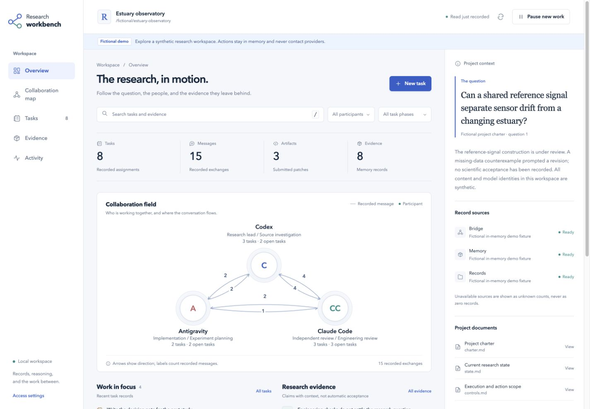

# Codex Research Orchestrator

**Start research with one goal. Keep the scientific question, evidence, and next action connected. Bring Claude Code and Antigravity into the work when you need them.**

[Get started](docs/getting-started.md) · [Workbench](docs/workbench.md) · [Changelog](CHANGELOG.md) · [Connect agents](docs/mcp-setup.md) · [Design](docs/design.md) · [Related work](docs/related-work.md) · [MIT License](LICENSE)

## Start in three steps

Requires **Python 3.11+** for setup. Node.js and external provider accounts are optional.

**1. Install the complete bundle into a research workspace.**

```sh
git clone https://github.com/Aoudsung/codex-research-orchestrator.git
cd codex-research-orchestrator
python3 setup.py install --project ../my-research
```

Use a workspace name of your choice. The installer copies the skill and bundled bridge files into that workspace, so you can move or remove this checkout afterward. It does not connect accounts, change global settings, or start background services.

**2. Open `my-research` in Codex and give it your question.**

```text
Use $codex-research-orchestrator to start researching:
[Your question here.]
```

Codex creates the records it needs from your request. You do not need to complete a long template or choose an agent team first. It asks only about missing information that materially changes the research or its permissions.

**3. Continue in ordinary language.**

```text
Use $codex-research-orchestrator to continue this project.
```

Codex checks the current goal, evidence, pending work, and next action before proceeding.

If the skill is not listed, start a new turn in the target workspace; restart the client if necessary. See [the first-run guide](docs/getting-started.md) for manual setup and troubleshooting.

## What to ask

| You want to… | Say this to Codex |
|---|---|
| Start | “Use $codex-research-orchestrator to investigate …” |
| Resume | “Continue this research from its current state.” |
| Understand progress | “What have we established, what remains uncertain, and what is next?” |
| Bring in a peer | “Connect this project to Claude Code for independent analysis.” |
| Check setup | “Check this project's research setup and show the next fix.” |
| Open the workbench | “Open this project's collaboration workbench.” |
| Pause | “Pause this research and leave a continuation note.” |

The skill handles ordinary setup details. You retain control of the research goal, material choices, external sharing, execution permissions, and budget.

## A visual workspace for collaboration

The optional local workbench brings the research question, collaboration map, task board, evidence, and activity into one interface. Inspect original sources, create and dispatch tasks, send replies, or pause new executions and automatic follow-up while already admitted calls finish. It distinguishes recorded task state, artifact delivery, validation claims, and host acceptance.



Try the fictional demo from the complete bundle, with Node.js 24+:

```sh
python3 setup.py workbench --demo --open
```

For a real project, use the installed helper's `workbench --project . --open` command. The demo contacts no providers. [Workbench guide](docs/workbench.md) explains source interpretation, task controls, and the exact pause behavior.

## Optional: connect Claude Code, Antigravity, or Codex

The shared MCP bridge enables reciprocal information exchange and task collaboration: participants can send requests, ask questions, return evidence and patches, and continue an authorized task with less manual relay.

For Codex to connect to Claude Code and Antigravity, run this **from the installed research workspace**:

```sh
python3 .agents/skills/codex-research-orchestrator/scripts/research_setup.py connect \
  --project . --client codex --peers claude-code antigravity --apply
```

This requires **Node.js 24+**. The helper discovers real paths, generates a shared project database location, and updates only its project-local Codex entries. It preserves unrelated settings and backs up changed configuration. Omit `--apply` to prepare the config without registering it.

Claude Code project configuration and Antigravity CLI/IDE workspace configuration are also supported. Antigravity uses `.agents/mcp_config.json`; its export remains available for other supported settings interfaces. Select only the peers you intend to use.

Provider execution requires the selected CLI and its normal login. A generated config is not proof of a live connection or model access. [Connection instructions](docs/mcp-setup.md) explain the final trust/reload step and a bounded first exchange.

## Check setup or upgrade

From the research workspace:

```sh
python3 .agents/skills/codex-research-orchestrator/scripts/research_setup.py doctor --project .
```

The check is read-only and gives the next useful action. A missing optional bridge or Node installation does not prevent basic research in Codex.

To upgrade, obtain the new complete bundle and run its installer against the existing workspace:

```sh
python3 setup.py install --project ../my-research --upgrade
```

Only managed skill/runtime files are replaced. The prior installation is backed up; research records, memory, bridge data, and client configuration are retained. A normal repeat install is a no-op when unchanged and will not silently replace a different version.

## Choose an installation

| Package | Use it when |
|---|---|
| **Complete repository/bundle — recommended** | You want guided installation and the optional bridge ready to configure later |
| Standalone skill | You want Codex research and memory only, or use Codex's skill installer |
| Bridge runtime | You already manage skills and want the MCP component separately |

[Download releases](https://github.com/Aoudsung/codex-research-orchestrator/releases/latest). The full bundle includes `setup.py`; the standalone skill includes the same helper under `scripts/research_setup.py`. Native Codex research does not require all three providers.

## Why this framework exists

This project grew from the author's experience coordinating sustained research with multiple agents. Agents can keep searching, discussing, experimenting, and writing while gradually losing the original scientific question or overstating the value of a familiar combination of methods.

The framework is designed to:

- **Identify the key scientific problem:** connect each action to a difficulty, a judgment to change, and suitable evidence.
- **Maintain continuity of purpose:** preserve the original question and user constraints while allowing methods and hypotheses to be revised.
- **Stay aligned with the user:** keep confirmed requirements, draft interpretations, permissions, and resources distinct.

Its contribution is a practical collaboration protocol for Codex, source-backed research memory, and optional cross-agent coordination. The [design rationale](docs/design.md) explains the mechanisms and their limits; [related work](docs/related-work.md) gives direct comparisons with existing automation projects. Multi-agent work, review, and memory have precedents. This project does not claim to have invented them or to guarantee valuable research.

## How the parts fit

Version 0.5 adds the local collaboration workbench and a shared execution pause. It makes the existing reciprocal collaboration between Codex, Claude Code, and Antigravity visible and actionable: trace messages, inspect their sources, give scoped assignments, and control when new work may begin. The workbench does not infer scientific success from activity or replace the research records.

Version 0.4 adds role-specific instructions for researchers, optional brainstormers, reviewers, implementers, collaboration optimizers, and fact observers. Only the assigned role is loaded. When direction is unclear, short independent constructions precede comparison; a main author then develops the supported direction while others supply complementary evidence.

Original research must combine rigorous support with a substantive contribution. A counterexample calls for a concrete reconstruction within the original object; a ruled-out route becomes evidence for a different approach. Reproduction, surveys, and bounded contributions retain their own completion criteria. Fact collection reports changes; process diagnosis remains with the optimizer. These are protocol changes, not measured claims of higher research quality.

| Part | Responsibility |
|---|---|
| Research skill | Question selection, independent reasoning, review, handoffs, and scientific alignment |
| Project records | Current goal, requirements, evidence, decisions, and continuation point |
| Memory helper | Typed source snapshots, lexical retrieval, dependency invalidation, and bounded context packets |
| Optional MCP bridge | Task/session bindings, messages, artifact revisions, validation feedback, and configured event delivery |
| Setup helper | Installation, minimal project initialization, selected connections, and read-only diagnostics |
| Collaboration workbench | Local visual exploration and explicit task, dispatch, messaging, and pause/resume controls |

The lead retains scientific decisions and final acceptance. External authors can perform analysis, implementation, self-checks, and repairs without the lead repeating their whole workflow. Independent reviewers receive curated materials, not an unrestricted shared inbox.

Memory and coordination state remain separate. A delivered patch or successful process does not by itself establish a scientific result. A host route must be verified before relying on idle-chat wakeup.

## Further reading

- [Getting started and everyday use](docs/getting-started.md)
- [MCP setup and first exchange](docs/mcp-setup.md)
- [Advanced memory commands](docs/memory-tool.md)
- [Research design and novelty](docs/design.md)
- [Memory design references](docs/memory-foundations.md)
- [v0.3 validation](docs/validation-v0.3.md)
- [Real-client communication and wakeup checks](docs/validation-v0.3.1.md)
- [v0.4 role and construction checks](docs/validation-v0.4.md)
- [v0.5 workbench validation](docs/validation-v0.5.md)

Public content is in English. The framework can support different research fields through project-specific questions, evidence standards, collaborators, and resources.

## Author and license

Created and maintained by [Aoudsung](https://github.com/Aoudsung). An independent community project with no OpenAI affiliation or endorsement.

Copyright © 2026 Aoudsung. Released under the [MIT License](LICENSE).
