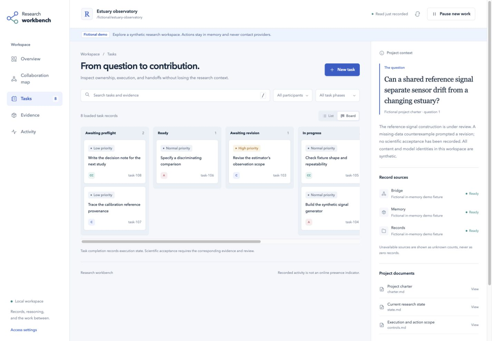
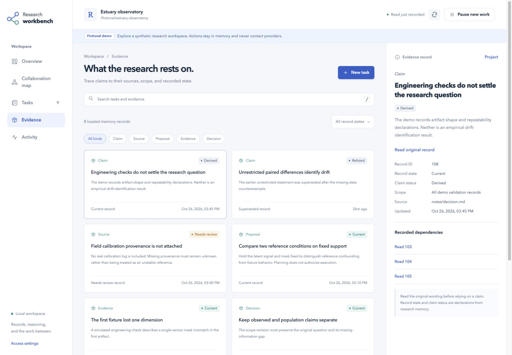

# v0.5.0: collaboration workbench validation

Date: 2026-10-26. This release adds a local browser workbench, task controls, and a persistent bridge pause. It retains the research protocol and memory data model. The pause table is an additive bridge schema change; existing research files and client configuration are preserved by `install --upgrade`.

## Scope and environment

Checks ran in a disposable Linux directory with Node.js 24.22.1 and Python 3.11.17. Browser interactions used the actual application through a loopback SSH forward. The workspace was a labelled, fictional in-memory demo. No running research project, live bridge database, provider account, or paid model call was used.

## Automated checks

All commands below completed with exit code 0 from the repository root:

```sh
node --test runtimes/agent-bridge/test/test-workbench.mjs
node runtimes/agent-bridge/test/test-all.mjs
python3 -m unittest discover -s tests -p test_research_setup.py
node --check runtimes/agent-bridge/src/workbench/public/app.js
```

The workbench suite passed **9 tests**, the existing bridge suite passed, and the setup suite passed **29 tests**. The targeted checks covered:

- Read-only browsing of present, missing, and unreadable sources; unread message state; bounded pagination; and memory observation without invalidation.
- Loopback access, bearer authentication, Host and Origin checks, JSON validation, scoped paths, static-file allowlists, and rejection of arbitrary execution overrides.
- Task creation and bridge preflight without dispatch; explicit model requirements; message receipts; asynchronous dispatch and duplicate protection.
- Pause persistence across database instances, serialized execution admission, retained pending work, unchanged route settings, and completion of already admitted operations.
- Provider MCP execution guards with synthetic adapters. Reads, messages, and non-execution operations remain available while paused.
- Fictional demo isolation and Unicode code-point source ranges across SQLite, project documents, and demo data, including complete task briefs beyond the preview.
- Complete installation, upgrade preservation, runtime asset validation, and workbench launch arguments through the existing setup helper.

The SQLite read-only comparison excludes `-shm` coordination bytes; it checks persistent database and WAL content and logical state. A shared-memory coordination update is not reported as a research-record mutation.

The final publication check passed 105 local Markdown references, synchronized release versions, the three MIT license copies, and exclusion of temporary runtime data. A separate read-only scan found no private project paths, real session identifiers, common credential patterns, or non-English text in the added workbench sources and guidance.

## Browser walkthrough

The desktop view was inspected at a 1440 × 1000 viewport and the narrow layout at 390 × 844. The narrow layout had no horizontal document overflow. Browser error and warning logs were empty at the end of the walkthrough.

The walkthrough checked authentication feedback, overview and collaboration map, task list and board, task creation, a full 1,235-character brief, literal HTML rendering, Unicode text, loaded-source download, evidence dependencies, and closing the source viewer with Escape. It also confirmed that pausing disables dispatch while permitting a saved message, resuming restores explicit dispatch, and simulated dispatch reports its own operation result without claiming the task or research is complete.

The screenshots show fictional records:

| Overview | Task board |
|---|---|
|  |  |



[Narrow layout screenshot](images/workbench-mobile.png).

## Review and limits

An independent engineering review found two actionable defects: pause had also blocked Antigravity's message-only question tool, and source pagination mixed UTF-16 lengths with SQLite code-point ranges. Both were corrected and covered by the final targeted tests. The direct runtime launch example was also corrected to require an explicit project.

These checks validate the implemented contracts and the inspected browser paths. They do not establish improved research quality, verify provider account access, or repeat live client communication and idle-chat wakeup tests. Earlier live-client evidence remains separately documented in [v0.3.1 validation](validation-v0.3.1.md).

After upgrading, connected MCP clients must be reopened to load the new pause guard. The control affects processes using this project's upgraded bridge; it does not terminate existing calls or pause unrelated clients and jobs. Temporary test sources, downloads, test processes, and isolated runtime installations are removed after publication; the formal source, screenshots, and this validation note are retained.
